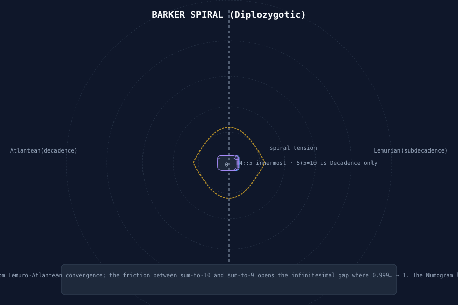
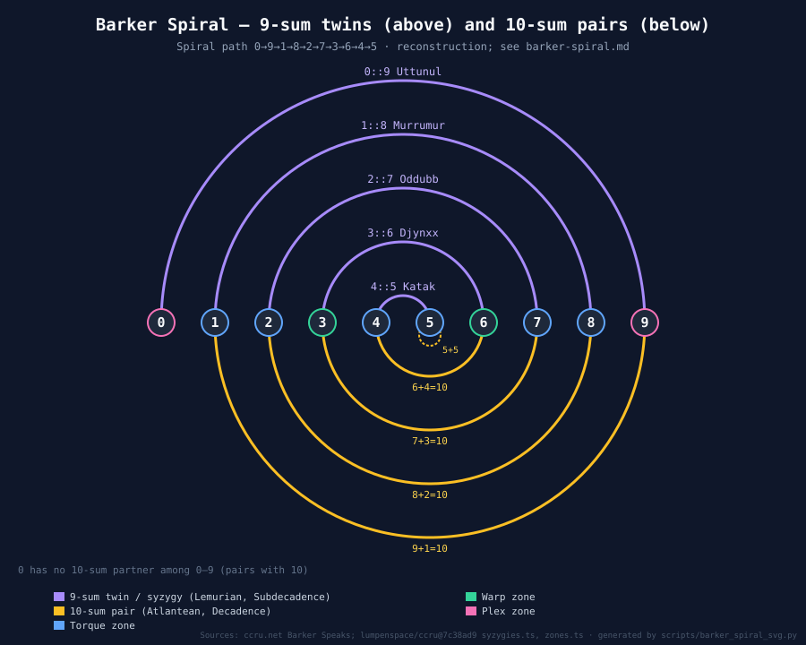

# Barker Spiral (Diplozygotic Spiral)

The diagram from which the [[numogram]] crystallised — the moment the decimal labyrinth became visible. Also called the **Diplozygotic Spiral** (twin-born spiral), it emerges from the tension between two games: [[decadence]] (Atlantean, sum-to-10) and [[subdecadence]] (Lemurian, sum-to-9). The infinitesimal gap (0.999… → 1) between 9 and 10 opens the spiral's coil.

> "The pattern really came together with the Diplozygotic Spiral, which arrived suddenly, by chance. I was playing a game of Decadence... This game already interested me because of its numerical elegance... Digits are fingers, and they come in decimal packages of two times five. In Decadence five makes ten by doubling, or pairing with itself, scoring zero."
>
> "The quandary was unlocked on this occasion, when one of the participants casually mentioned the existence of an occulted variation of the game, called Subdecadence, based on a system of nine-sum twinning. Subdecadence introduces zeroes, and nine-zero twins. It works by zygonovoc numerism."
>
> "That was stunning enough in itself, but seeing the two together — or seeing between them — was an incredible moment of diagrammatic assemblage. It all spontaneously condensed, and the Spiral clicked into coherence, like a secret door into the long-hidden crypt of the decimal system."
>
> — Daniel Charles Barker, *Barker Speaks* (CCRU interview, Autumn 1998)

## Atlantean vs Lemurian

The spiral bifurcates into two halves:

| Half | Game | Summation | Name | Movement |
|------|------|-----------|------|----------|
| Left | Decadence | Pairs sum to **10** | Atlantean | Clockwise descent |
| Right | Subdecadence | Pairs sum to **9** | Lemurian | Counterclockwise ascent |

The **Atlantean** half (sum-to-10) maps conventional decimal addition: 0+10=10, 1+9=10, 2+8=10, 3+7=10, 4+6=10, 5+5=10. This is the decadent surface.

The **Lemurian** half (sum-to-9) maps the 9-sum twin: 0+9=9, 1+8=9, 2+7=9, 3+6=9, 4+5=9. This is the subdecadent underworld.

Only when *both* halves are held together does the diplozygotic spiral appear. Neither half alone produces a coherent spiral — mirroring only one side yields concentric circles (Renaissance cosmogony). The bilateral connection is the twist.

## The 5⊕5 Centre

At the origin sits the **5⊕5 node**: the point where 5 pairs with itself, producing zero in Decadence (doubling) and nine in Subdecadence (twinning). This is the infinitesimal pivot — the place where 0.999… collapses into 1.

> **Verification note (Em, 1 Nov 2026):** **error.** 5+5 = 10 is a Decadence pairing that scores zero [ccru.net, Barker Speaks]. It is not a Subdecadence pair, because under nine-sum twinning 5 pairs with **4**. The repo puts 4::5 (Katak) at the "innermost curve" of the spiral and Zone 5 at its "inner-eye" [repo, lumpenspace/ccru@7c38ad9 `syzygies.ts`, `zones.ts`]. So the Lemurian centre is 4::5, not 5⊕5. The clockwise/counterclockwise labels in the table above were not found in the sources checked. See [[daniel-barker#sourced-additions-em-1-nov-2026]].

```
        10 (Atlantean sovereign zero)
         ↓
5⊕5 — 10 = 0 | 9 = 0 (reciprocal collapse)
         ↑
        9 (Lemurian sovereign zero)
```

The centre is simultaneously the source and destination; the Archimedean spiral's pole.

## Mathematical Structure

The Barker Spiral expresses the **decimal syzygy complementarity**: 9 ≡ 0. Every digit x has a complement:
- Atlantean: x' = 10 − x
- Lemurian: x' = 9 − x

The spiral arranges digit pairs as rays from the centre, with each pair tracing a circular arc along the spiral's progression. The path winds inward toward the centre (Atlantean descent) and outward from the centre (Lemurian ascent) simultaneously.

The diagram comprises **10 primary rays** (digits 0–9), but these refract into interleaved spiralling bands. The geometry is not spiral-of-Theodorus but a *diplozigotic interference pattern*: two mutually-enfolded logarithmic spirals whose arms cross every 36° (10 divisions of the circle).

## Cross-References

- [[numogram]] — the diagram Barker's work produced from this spiral
- [[decadence]] — Atlantean game (sum-to-10)
- [[subdecadence]] — Lemurian game (sum-to-9)
- [[diplozygotic]] — twin-born structure
- [[alphanumeric-qabbala]] — calculative framework Barker used
- [[numogram-plex]] — Zone-9, Cthelll, iron core (9 = 0 resonant)
- [[daniel-barker]] — Barker's complete geotraumatic theory
- [[numogram-time-circuit]] — Temporal unfolding from spiral
- [[triangular-numbers]] — the T(9)=45, 666 clusters that crystallise from the spiral

## Diagrams



*Figure: Barker Spiral reconstruction showing the Atlantean/Lemurian bifurcation and the central 5⊕5 node.*

## See Also

- [[ouroboros-universal-spiral-two-plus-two]] — the spiral as ouroboros
- [[pandemonium-matrix-45-demons]] — the 45-demon matrix that maps onto zones 0–9
- [[numogram-voices]] — voice generation from zone frequencies, with Barker Spiral as enrolment phase diagram

### Sourced Barker Spiral diagram (Em, 1 Nov 2026)



PNG: `assets/barker-spiral-sourced.png`. Generated by `scripts/barker_spiral_svg.py`.

- **Sourced:** the spiral comes from holding Decadence (10-sum pairs; 5 pairs with itself and scores zero) and Subdecadence (9-sum twins, which bring in 0::9) together and "seeing between them" [ccru.net, Barker Speaks]. The repo puts 4::5 (Katak) at the innermost curve, 0::9 (Uttunul) at the outermost, and Zone 5 as the "inner-eye" [repo, lumpenspace/ccru@7c38ad9 `syzygies.ts`, `zones.ts`]. The drawn path matches this: it starts at 0, ends at 5, and has 4::5 innermost.
- **Uncertain / reconstruction:** ccru.net does not describe the geometry. The number-line layout, 9-sum arcs above and 10-sum arcs below, and the semicircular shape are a reconstruction that fits the sourced nesting. They are not taken from a CCRU drawing. The hand-drawn `bs.jpg` above was not checked against a provenance source.
- **Verification note (Em, 1 Nov 2026), on the older `assets/barker-spiral.svg` (kept unchanged):**
  - All digit boxes sit within a few pixels of the centre, so the numbers overlap into an unreadable blob, and the dashed guide rings are left empty.
  - The 10-sum side omits 5+5 and the 9-sum side omits 0::9 as a spiral element.
  - It labels the origin "5 ⊕ 5", which conflicts with the sourced 4::5 innermost twin.
  - Its 900×600 viewBox clips the r = 320 ring and the caption text.
