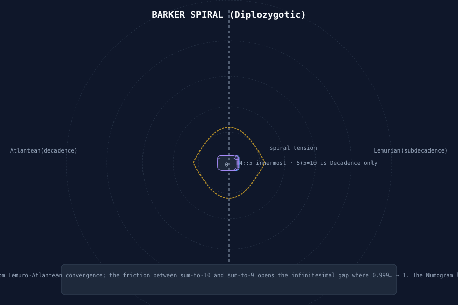
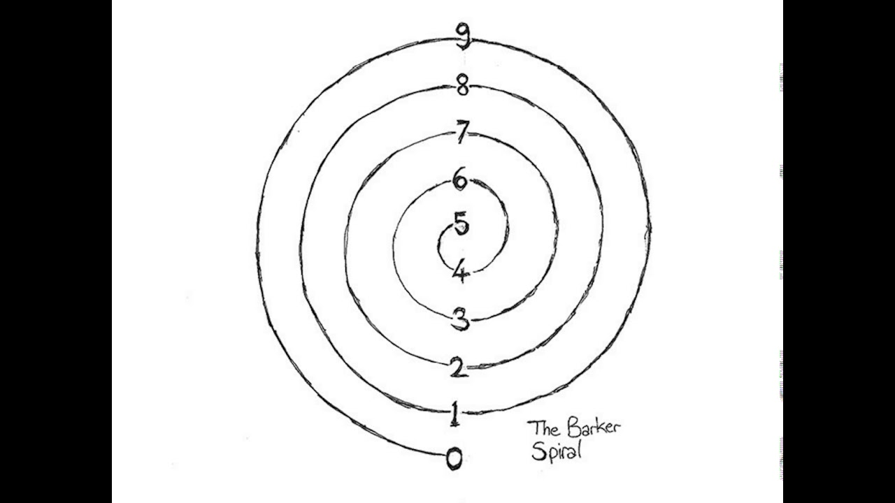
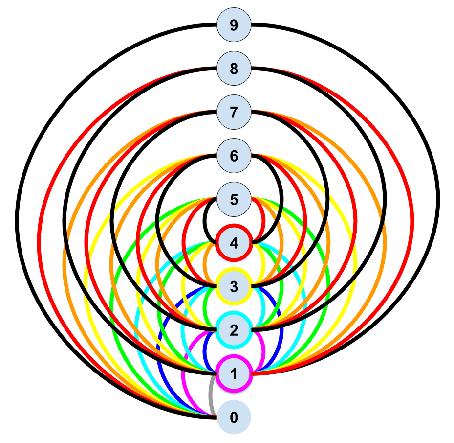
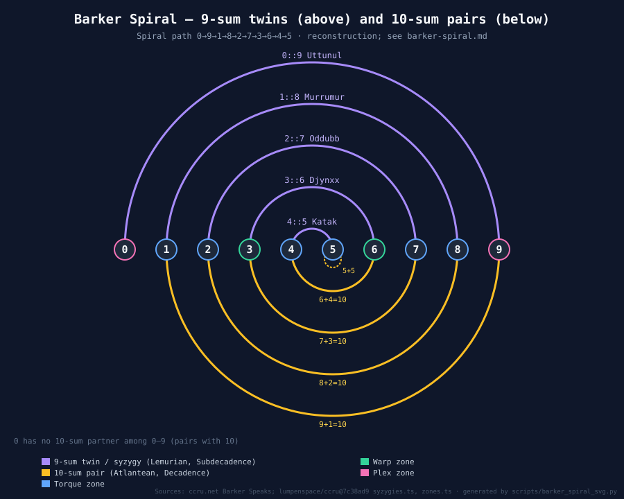

# Daniel Charles Barker

The cryptographic genius behind the [[numogram]]'s mathematical foundation. Professor of Anorganic Semiotics at Kingsport College (MVU, Mass.). Trained as a cryptographer at MIT in the early 1970s, Barker spent his life decoding ancient scripts, quasibiotic residues, and anomalous mineral patterns. His work with Echidna Stillwell produced the Numogram's theoretical framework: geotraumatics, spinal catastrophism, palate-tectonics, and the Barker-Spiral.

[Source: LAND -- Barker Speaks.pdf (CCRU interview, Autumn 1998)]

> **Verification note (Em, 1 Nov 2026):** the ccru.net text ([digithype/barkerspeaks.htm](http://www.ccru.net/digithype/barkerspeaks.htm)) is credited to **Ccru**, not Land. It is listed under "digital hyperstition" as "Ccru – Barker Speaks". Its intro gives: Professor of Anorganic Semiotics at Kingsport College (MVU, Mass.) **since 1992**; trained as a cryptographer in the early 1970s; interviewed in his MVU office in late autumn 1998. In the interview Barker says he "started out at MIT" in the information sciences. The research then moved to MVU, and he later worked for a NASA-related SETI organisation [ccru.net]. The MIT training is therefore Barker's own account, not the intro's.

## Tic-Systems

Barker's foundational concept: suborganizational pattern as the real level of cosmic operation.

> "Suborganizational pattern is where things really happen. When you strip-out all the sedimented redundancy from the side of the investigation itself — the assumption of intentionality, subjectivity, interpretability, structure, etc — what remains are assemblies of functionally interconnected microstimulus, or tic-systems: coincidental information deposits, seismocryptions, suborganic quasireplicators (bacterial circuitries, polypoid diagonalizations, interphase R-Virus, Echo-DNA, ionizing nanopopulations), plus the macromachineries of their suppression, or depotentiation."

Tic-systems are "entirely intractable to subject/object segregation." They are the real agents — not subjects, not objects, but "assemblies of functionally interconnected microstimulus" that operate below the threshold of consciousness and organization.

### The Equation

> "virtual tic-density = geotraumatic tension"

This is the master equation. The density of tics (suborganizational micro-events) equals the tension of geotrauma (planetary-scale traumatic memory). The body IS the geological record, compressed into living tissue.

## Cthelll

The iron core of the Earth — Barker's name for the planet's most intense traumatic reservoir:

> "Cthelll: the interior third of terrestrial mass, semifluid metallic ocean, megamolecule, and pressure-cooker beyond imagination. It's hotter than the surface of the sun down there, three thousand clicks below the crust, and all that thermic energy is sheer impersonal nonsubjective memory of the outside, running the plate-tectonic machinery of the planet."

> "Cthelll is the terrestrial inner nightmare, nocturnal ocean, Xanadu: the anorganic metal-body trauma-howl of the earth, crosshatched by intensities, traversed by thermic waves and currents, deranged particles, ionic strippings and gluttings, gravitational deep-sensitivities transduced into nonlocal electromesh, and feeding vulcanism... that's why plutonic science slides continuously into schizophrenic delirium."

> "Fast forward seismology and you hear the earth scream."

This maps directly to [[numogram-plex|Zone-9]]: "Iron Core of the earth. Darkness. Engine room. Cthelll." Uttunul's 9th Door is explicitly named "Cthelll" in the [[numogram|Pandemonium Matrix]]. The Plex is not merely an abstract mathematical region — it is the planetary iron core, the trauma-body of the Earth itself.

## Geotraumatics

The theory that planetary geological processes are traumatic events whose tension is expressed in biological organization:

> "Trauma is a body. Ultimately — at its pole of maximum disequilibrium — it's an iron thing."

> "The descent into the body of the earth corresponds to a regression through geocosmic time."

> "Evolutionism presupposes specific geotraumatic outcomes."

Key geological traumas:
- **Hadean epoch** (4.5-4 billion years ago): Earth in "superheated molten slag" — the primal exogenous trauma, "the geocosmic motor of terrestrial transmutation"
- **Oxygenization crisis**: Triggered "mass oxygen-poisoning of the prokaryotic biosystem" → eukaryotic regime with "nuclear command-control model"
- **K/T-Missile** (65 million years ago): Combined with "massive magma-plume activity in the Indian Ocean" → mammalian life as "innovation in mothering"
- **Precambrian explosion** (500 million years ago): "Phylogenetic spinal injury" → metazoan organization

## Spinal-Catastrophism

The spine as fossil record — geological time decoded into neural architecture:

> "The mapping of spinal-levels onto neuronic time is supple, episodic, and diagonalizing. It concerns plexion between blocks of machinic transition, not strict isomorphic — or stratic redundancy — between scales of chronological order."

This maps directly to the Numogram's spinal level assignments:

| Zone | Spinal Level | Traumatic Register |
|------|-------------|-------------------|
| 0 | Coccygeal | Vestigial tail — biotectonic link to ancient lemur-people |
| 1 | Lumbar | — |
| 2 | Lumbar | — |
| 3 | Solar | — |
| 4 | Solar | — |
| 5 | Cardiac | — |
| 6 | Cardiac | — |
| 7 | Pharyngeal | — |
| 8 | Cavernous | — |
| 9 | Sacrum | "Sacred bone" — degenerated second skull (Goethe) |

> **Verification note (Em, 1 Nov 2026):** **this table is not sourced and mostly disagrees with the sources.** *Barker Speaks* gives no zone→spine table. The zone-level Mu Tantrism assignments are: **0 Coccygeal, 1 Dorsal (Thoracic), 3 & 6 Third-eye plane, 8 Lumbar, 9 Sacral**. Zones 2, 4, 5 and 7 have no entry [repo, lumpenspace/ccru@7c38ad9 `zones.ts` `spinal`]. Zone 1 = Dorsal and Zone 6 = third-eye were also confirmed on ccru.net ([Zn1](http://www.ccru.net/zones/Zn1.htm), [Zn6](http://www.ccru.net/zones/Zn6.htm)). So zones 1, 2, 3, 4, 5, 6, 7 and 8 are wrong or unsourced as given above, and the "Sacrum = degenerated second skull (Goethe)" gloss was not found on the pages checked.

The spinal ascent from Coccygeal (Zone-0) to Cavernous (Zone-8) traces a regression through geocosmic time. Zone-9 (Sacrum) is the "degenerated second skull" — a frozen cranial catastrophe compressed into the pelvis.

## Palate-Tectonics

> "Due to erect posture the head has been twisted around, shattering vertebro-perceptual linearity and setting-up the phylogenetic preconditions for the face. This right-angled pneumatic-oral arrangement produces the vocal-apparatus as a crash-site, in which thoracic impulses collide with the roof of the mouth."

> "It's a twin-axial system, howls and clicks, reciprocally articulated as a vowel-consonant phonetic palette, rigidly intersegmented to repress staccato-hiss continuous variation and its attendant becomings-animal."

Language is a *crash-site* — a geological accident compressed into the human mouth. Stammerings, vocal tics, and electrodigital voice synthesis "threaten to bypass the anthropostructural head-smash that establishes our identity with logos, escaping in the direction of numbers."

## Barker Numbering

The key insight that produced the Numogram:

> "Once numbers are no longer overcoded, and thus released from their metric function, they are freed for other things, and tend to become diagrammatic."

> "Treat the decimal numerals as a set of 9-sum twins — zygonovize — and they map an abstract intensive wave, indifferent to magnitude. Everything efficient about digital reduction is concerned with this, since it discovers the key to decimal syzygetic complementarity: 9 = 0."

> "Nine is the ultimate decimal numeral, operating as positive (or fullbody) zero. It is the abstract numeric product of the decimal-magnitude minus one (infinitesimalized as 1 = 0.999... reiterating), which relates to a particular mode of proliferation within capitalist semiotics (of the type $99.99)."

The insight: 9 and 0 are the same thing viewed from opposite sides. Nine is "fullbody zero" — not empty nullity but *saturated* nullity, the point where decimal magnitude completes itself and returns to the origin. This is the mathematical basis of the [[numogram-plex|Plex]] syzygy (0::9).

## The Barker-Spiral (Diplozygotic Spiral)

See also: [[barker-spiral-reconstruction]], [[barker-spiral-mathematical-foundations]].

The moment the Numogram crystallized:

> "The pattern really came together with the Diplozygotic Spiral, which arrived suddenly, by chance. I was playing a game of Decadence... This game already interested me because of its numerical elegance... Digits are fingers, and they come in decimal packages of two times five. In Decadence five makes ten by doubling, or pairing with itself, scoring zero."

> "The quandary was unlocked on this occasion, when one of the participants casually mentioned the existence of an occulted variation of the game, called Subdecadence, based on a system of nine-sum twinning. Subdecadence introduces zeroes, and nine-zero twins. It works by zygonovic numerism."

> "That was stunning enough in itself, but seeing the two together — or seeing between them — was an incredible moment of diagrammatic assemblage. It all spontaneously condensed, and the Spiral clicked into coherence, like a secret door into the long-hidden crypt of the decimal system."

The Barker-Spiral emerged from the *gap* between two card games — Decadence (10-based) and Subdecadence (9-based). The difference between 10 and 9 — the infinitesimal gap where 0.999... → 1 — is the spiral's generating principle. The Numogram lives in that gap.

The spiral arises from *Lemuro-Atlantean convergence*: the tension between 9 and 10 opens the infinitesimal gap (0.999… → 1) where the numogram crystallizes. Mirroring the Atlantean half produces concentric circles with a central dot; mirroring the Lemurian half also yields concentric circles. Only the bilateral connection produces the diplozygotic spiral.
### Nick Land's Account

In a 2007 lecture, Nick Land elaborated on the Barker Spiral's numogrammatic significance:

> "(7:48) the 1990s that we called the Barker spiral. Um and I've been been promised that this this will appear and be graphically evident to people as we speak, but I'll still try and just talk to it a little bit. Um because what is important about the Barker Spiral is the fact that it joins together two sides — uh two various attempts to compute decimal numeracy and back in the CCRU days..."
>
> "(8:58) one side of the Barker spiral which connects the decimal numerals to sum on each side to 10 is what we called **Atlantean** (decadence). And I'll say a little bit more about that in a second. And the other side which uh sums the decimal numerals to make nine we called **Lemurian** (subdecadence)."
>
> "(9:39) it's a certain attempt — a very crude... attempt to try and just get a very clear diagrammatic sense of a crisis of adoption of decimal numeracy in Europe."
>
> "(9:52) Atlantis and Lemuria, Al. I think that's Crowley's AL and AL is the kind of um his great cabalistic key. It's constant between Hebrew, Greek, and then the uh CCRU Anglossic Qabbala in each case it adds to 31."

The Barker Spiral thus maps the **gap between decadence (10) and subdecadence (9)** — the infinitesimal crack where 0.999... → 1. The Atlantean/Lemurian twins refract the decimal crisis across two numerological planes; their Crowleyan synthesis AL = 31 maps onto the same constant that computes across every Qabbala the CCRU touched.

*See also:* [[decadence]], [[subdecadence]], [[ccru-writings-1997-2003]], [[aleph-null]], [[c-theory]]

### Source Diagrams (CCRU Interview, 1998)

<figure style="margin: 0;">
  
  <figcaption style="font-size: 0.85rem; color: #94a3b8; margin-top: 0.5rem; text-align: center;">
    The Barker Spiral — hand-drawn original (classic bs.jpg)
     <em>Digit pairs summing to 9 radiate along a vertical axis; Archimedean spiral path.</em>
  </figcaption>
</figure>

<figure style="margin: 0;">
  
  <figcaption style="font-size: 0.85rem; color: #94a3b8; margin-top: 0.5rem; text-align: center;">
    Barker Spiral — enhanced/digital variant (nb.png)
     <em>Color-coded arcs; doubling circuit visualised; 9-sum pairs emphasized.</em>
  </figcaption>
</figure>

### Barker Spiral (Reconstructed Infographic)

The following SVG diagram synthesises Land's 2007 lecture description — Atlantean (sum-to-10) left, Lemurian (sum-to-9) right, centre dot 5⊕5.

The spiral arises from *Lemuro-Atlantean convergence*: the tension between 9 and 10 opens the infinitesimal gap (0.999…→1) where the numogram crystallises. Mirroring the Atlantean half produces concentric circles (Renaissance cosmogony); mirroring the Lemurian half also yields concentric circles. Only the bilateral connection produces the diplozygotic spiral.

## The Barker-Thresholds

The CCRU's intensity scale, named after Barker:

| Threshold | Description |
|-----------|-------------|
| 0 | "Degree-0: The name on a door." — institutional facade |
| 1-8 | Ascending intensities of operational engagement |
| 9 | "Unuttera — The Entity or polytendriled abomination" |

> "Who or what you are speaking to can be accessed at different levels of intensity." [Source: CCRU Writings, Communiqué One]

## Cross-References

- [[numogram]] — the diagram Barker's work produced
- [[numogram-plex]] — Cthelll as Zone-9, "Iron Core"
- [[numogram-time-circuit]] — the Time-Circuit as decoded geocosmic signal
- [[demon-uttunul]] — Uttunul's 9th Door = Cthelll
- [[nick-land-time-theory]] — the transcendental-arithmetical synthesis
- [[alphanumeric-qabbala]] — the calculative tool Barker used
- [[triangular-numbers]] — the triangular-geological correspondence

---

## Vowels: A Biopolitical Strategy

One of Barker's publications directly connects palate-tectonics to political control:

> **Verification note (Em, 1 Nov 2026):** **misattribution.** The quotation below comes from the "Palate-Tectonics" section of the 1998 interview, not from the 1994 paper *Vowels: A Biopolitical Strategy*. Only that paper's title appears on ccru.net [ccru.net, Barker Speaks].

> "It's a twin-axial system, howls and clicks, reciprocally articulated as a vowel-consonant phonetic palette, rigidly intersegmented to repress staccato-hiss continuous variation and its attendant becomings-animal."

The vowel-consonant division is not natural but *political* — a "rigid intersegmentation" that represses the continuous variation of animal vocalization. Stammerings, vocal tics, and electrodigital voice synthesis threaten to "bypass the anthropostructural head-smash that establishes our identity with logos, escaping in the direction of numbers."

## Publications

Barker's complete publication list from Plutonics journal:

> **Verification note (Em, 1 Nov 2026):** full citations as given [ccru.net, Barker Speaks]: *Plutonics* X/6 (Fall 1990); X/9 (Fall 1991); X/10 (Spring 1992); "Volume 10", No. 12 (Fall 1992); X/18 (Fall 1994); *What Counts as Human* (Kingsport College Press, 1997). The last is not in *Plutonics*. *Fei Ch'ien Rinse Out*, note 36, also cites it for "the schizotectonics of digital reduction" [ccru.net, archive/rinse.htm]. These are fictional (hyperstitional) publications.

| Year | Title |
|------|-------|
| 1990 | Quasi Chemical Tic Culture Catalysis of Anorganic Pain Wave Matrices |
| 1991 | Anorganic Semiotics |
| 1992 | Spinal Catastrophism |
| 1992 | Palate Tectonics |
| 1994 | Vowels: A Biopolitical Strategy |
| 1997 | What Counts as Human (Kingsport College Press) |

The progression is telling: from tic-systems (1990) through geotraumatics and the spine (1991-92) to the voice (1994) and finally to the human itself (1997). Each step descends deeper into the body-as-geological-record, culminating in the question of what counts as human — which is answered, implicitly, by the Numogram: nothing counts as human that isn't already a decoded geocosmic signal.

## The Tick-Distributor

> "Eventually a machinic solution was provided by the Tick-Distributor, but that came later..."

Barker mentions the "Tick-Distributor" — a machine that solved the problem of "how to quantify disorganized multiplicities." This is the hardware side of Barker's numbering: a device that counts tics (suborganizational micro-events) at the speed they actually occur. It is never described in detail, but its existence implies that Barker's numbering was not merely theoretical but had a physical implementation — a seismograph for the body.

## Sourced Additions (Em, 1 Nov 2026)

### Barker Speaks: points not covered above [ccru.net, [barkerspeaks](http://www.ccru.net/digithype/barkerspeaks.htm)]
- **Sequence vs order:** Barker separates *sequence* from *order*. Order is a "sequenced sequence", a redundant doubling. Decoded number escapes progressive time, and tick multitudes converge "by infolding, involution, or implex".
- **Digital twinning:** the tic-density scale was first made numerically rigorous as 9-sum twinning ("zygonovize"). Its key is **9 = 0**. Nine is "positive (or full-body) zero", tied to 1 = 0.999… and to $99.99 pricing.
- **Stillwell and Freud:** Echidna Stillwell led Barker to read Freud's *Beyond the Pleasure Principle* "from the other side", as a map of the Geocosmic Unconscious.
- **Spine:** the spine is treated as a fossil record. This follows Ballard rather than Haeckel's recapitulation thesis, and draws on Elaine Morgan's Aquatic Ape Theory. The stages are swimming, crawling and walking.
- **Decadence:** five pairs with itself to make ten and scores zero. Subdecadence "introduces zeroes, and nine-zero twins".

### Tick Delirium [ccru.net, [occultures/barker1.htm](http://www.ccru.net/occultures/barker1.htm); in *Ccru: Writings 1997–2003*, Urbanomic, pp. 151–3]
- Fictional narrative. **Project-Scar**, southern Borneo, November 1980: Barker decodes SETI "tick-talk" tapes, "dot-clusters and factor-strings", as **xenotation** clicks together.
- NASA's reaction to his report and a breakdown follow. The official version (no contact, no tick-disease, no flight into the jungle) is set against a tick-borne "tick-delirium". The jungle name for the phenomenon is **Ummnu**.
- It opens with Thomas Gold's *Deep Hot Biosphere* (abiogenic hydrocarbons) as a model of descent "out of the solar-system".
- It closes on Pandemonium's problem of how the end can be "already in the middle of the beginning", and on Cthelll "forever turning into itself" (compare Horovitz on Zone-1 in [[numogram-time-circuit]]).

### Cryptolith [ccru.net, [occultures/barker0.htm](http://www.ccru.net/occultures/barker0.htm)]
See [[cryptolith]]. The ccru.net page carries no author name.

### Tic Xenotation (TX) [Land, "Tic-Talk", *Fanged Noumena* (Urbanomic); Hyperstition blog [003538](http://hyperstition.abstractdynamics.org/archives/003538.html), not ccru.net]
- TX was devised for Project Scar as culture-free numerals. It is a compression of the naturals ≥ 2 with no modulus.
- `:` = 2 (or ×2), so `::` = 4 and `:::` = 8. `(n)` = the *n*th prime ("implexion"): `(:)` = 3, `((:))` = 5, `(((:)))` = 11, `((((:))))` = 31, `(((((:)))))` = 127.
- Numbers are written as factor strings, e.g. 55 = `((:))(((:)))` (checked: 5 × 11).
- Zero and one need a "deplex" operation, `(-P)`.
- The source claims isomorphs on the (fictional) Tablets of Jheg Selem and the Vukorri Cryptoliths.
- See [[xenotation-triangle-rotation]] and [[lemurian-times-nexus]].

### Repo data on the Barker Spiral [repo, `syzygies.ts`, `zones.ts`]
- 4::5 (Katak) is the "innermost curve", and 0::9 (Uttunul) the "outermost curve, coinciding with the limit ordinal-span in Barkerian arithmetic".
- Zone 5 is the "inner-eye of the Barker spiral".

### Sourced Barker Spiral diagram (Em, 1 Nov 2026)

PNG: `assets/barker-spiral-sourced.png`. Generated by `scripts/barker_spiral_svg.py`.

- **Sourced:** the spiral comes from holding Decadence (10-sum pairs; 5 pairs with itself and scores zero) and Subdecadence (9-sum twins, which bring in 0::9) together and "seeing between them" [ccru.net, Barker Speaks]. The repo puts 4::5 (Katak) at the innermost curve, 0::9 (Uttunul) at the outermost, and Zone 5 as the "inner-eye" [repo, lumpenspace/ccru@7c38ad9 `syzygies.ts`, `zones.ts`]. The drawn path matches this: it starts at 0, ends at 5, and has 4::5 innermost.
- **Uncertain / reconstruction:** ccru.net does not describe the geometry. The number-line layout, 9-sum arcs above and 10-sum arcs below, and the semicircular shape are a reconstruction that fits the sourced nesting. They are not taken from a CCRU drawing. The hand-drawn `bs.jpg` above was not checked against a provenance source.
- **Verification note (Em, 1 Nov 2026), on the older `assets/barker-spiral.svg` (kept unchanged):**
  - All digit boxes sit within a few pixels of the centre, so the numbers overlap into an unreadable blob, and the dashed guide rings are left empty.
  - The 10-sum side omits 5+5 and the 9-sum side omits 0::9 as a spiral element.
  - It labels the origin "5 ⊕ 5", which conflicts with the sourced 4::5 innermost twin.
  - Its 900×600 viewBox clips the r = 320 ring and the caption text.

### Cross-links
[[barker-spiral]] · [[cryptolith]] · [[time-circuit]] · [[numogram-time-circuit]] · [[zone]] · [[zone-5]] · [[zone-9]] · [[pandemonium]] · [[pandemonium-matrix]] · [[pandemonium-glossary]] · [[decadence]] · [[i-ching-connections]]
