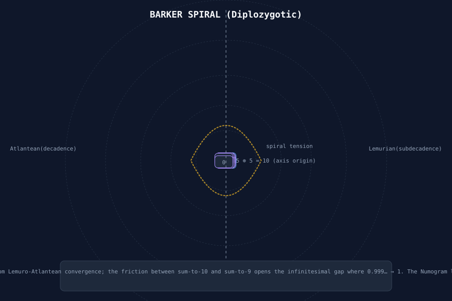

# Decadence (Atlantean Side)

> **Verification note (Em, 1 Nov 2026):** the opening paragraph and the "Lemurian Numeracy" / "Geotraumatic Undertow" sections below were copied from [[subdecadence]]. They describe the **9-sum** Lemurian game, not Decadence. Decadence is the **10-sum**, Atlantean game [ccru.net, [Pandemonium](http://www.ccru.net/digithype/pandemonium.htm)]. Read those sections as Subdecadence material.


The Lemurian half of the [[barker-spiral]]: the occulted variation whose sum-to-9 twinings reveal the *subdecadent underworld*. In Barker's narrative, Subdecadence was the "casually mentioned" variation that unlocked the crisis.

> \"Subdecadence introduces zeroes, and nine-zero twins. It works by zygonovic numerism.\"
> — Daniel Charles Barker, *Barker Speaks* (CCRU interview, Autumn 1998)

## Rules (Reconstructed)

- **Players:** 2 or more
- **Equipment:** Two standard decks of cards
- **Objective:** Form pairs whose values sum to **10**
- **Scoring:** Zero is sovereign (9 wraps to 0 via 9‐sum complementarity)

> **Verification note (Em, 1 Nov 2026):** **errors in this reconstruction.**
- The game uses **one** standard pack cut to 36 cards, not two decks.
- Tens are **removed**, so there is no "10 = 0" and no 0+10 pair.
- Zero appears only in Subdecadence, where Queens count as 0.
See "Sourced Rules and Context" below.


Each card maps to a digit (Ace = 1 through 10 = 0). Pairs sum to ten: 0+10, 1+9, 2+8, 3+7, 4+6, 5+5. The twist: zero is *not* a void but a *saturated convergence* — since 9 wraps to 0 in decimal reduction, the nine‐sum becomes the zero‐sum.

## Lemurian Numeracy

Subdecadence operates on **9‐sum equivalence**: x + (9 − x) = 9 ≡ 0 (mod 9). This is *zygonovoc numerism* — the art of twin pairing under the non‐decimal (decadence‐minus‐one) regime.

```
        0  (9 via 9+0; zero as saturated null)
        ↓
9 — 9+0=9 (≡0)  0 — 0+9=9 (≡0)
        ↗           ↖
8 — 8+1=9        1 — 1+8=9
        ↗           ↖
7 — 7+2=9        2 — 2+7=9
        ↗           ↖
6 — 6+3=9        3 — 3+6=9
        ↘           ↙
         4⊕5 (sums to nine; the Lemurian axis)
```

The Lemurian axis is a *diagonal mirror* through the digit set. Every number acquires a complement 9 − x. This is the *geotraumatic* register: the crack in decimal coherence where traumatic memory (Cthelll, the iron core) leaks through.

## Geotraumatic Undertow

Where Decadence enforces surface symmetry (10 = return to origin), Subdecadence reveals the **9‐gap**. Nine is the last digit before wrap; it is also the point where digital reduction *fails to resolve*:

> \"Once numbers are no longer overcoded, and thus released from their metric function, they are freed for other things, and tend to become diagrammatic.\"
> 
> \"Treat the decimal numerals as a set of 9‑sum twins — zygonovize — and they map an abstract intensive wave, indifferent to magnitude. Everything efficient about digital reduction is concerned with this, since it discovers the key to decimal syzygetic complementarity: 9 = 0.\"

Subdecadence thus maps the **crypt of the decimal system**. If Decadence is the manifest order (10‐based, capitalist numeracy), Subdecadence is the latent code (9‐based, geotraumatic register). The spiral does not emerge until *both* registers are held simultaneously.

## Cross-References

- [[barker-spiral]] — both halves together
- [[subdecadence]] — Lemurian counterpart (sum-to-9)
- [[decadence-subdecadence-comparison]] — systematic table of differences
- [[numogram]] — the diagram that crystallises from deca + subdeca
- [[daniel-barker]] — Barker's account of discovering the spiral
- [[numogram-plex]] — Zone-9 as the 9‐sum twin territory
- [[pandemonium-matrix-45-demons]] — the 45‐demon set derives from 9–10 nodal tension

## Diagram



> **Verification note (Em, 1 Nov 2026):** this older SVG has known defects (see [[barker-spiral]]). The sourced replacement is `assets/barker-spiral-sourced.svg`, which shows the 10-sum pairs below the line.

*Shown: left‐hand (clockwise) Decadence bands. The central 5⊕5 pair sums to ten; arms radiate outward through 10‐sum complementarity.*

## Gameplay Summary

From the online implementations and CCRU descriptions:

**Objective:** Survive as long as possible without letting the cumulative score drop to zero or below.

**Setup:**
- Two standard 36-card decks (ranks 1–9, four suits each)
- Cards are dealt into two sets:
  - **Set-1 (Atlantean Cross):** Five cards dealt face-up in a cross pattern
  - **Set-2:** Five cards dealt face-down in a row below

**Gameplay:**
- Flip the top card of Set-2 one at a time.
- If it can be paired with a face-up Set-1 card to sum to 10 (e.g., 1+9, 2+8, 3+7, 4+6, 5+5), click that Set-1 card to bind them.
- **Bonuses:** Certain pairs yield bonus points:
  - 1 + 9 = +8
  - 2 + 8 = +6
  - 3 + 7 = +4
  - 4 + 6 = +2
  - 5 + 5 = 0 (no bonus)
- **Penalties:** Any unpaired Set-1 card at the end of a round incurs a penalty equal to its rank (e.g., an unpaired 7 costs 7 points).
- **Collapse:** When the cumulative score drops to 0 or below, the aeon fractures and a demon from the Pandemonium Matrix manifests, ending the game.

**Example:** If Set-1 shows 1, 3, 5, 7, 9 and the first three Set-2 cards are 9, 2, and 4:
- Pair 1+9 = +8 (bonus)
- Pair 3+7 = +4 (bonus)
- 5 remains unpaired → -5 penalty
- Cumulative score: 8 + 4 - 5 = +7

> **Verification note (Em, 1 Nov 2026):** **the example is wrong.** 3+7 cannot be paired, because both cards are in Set-1 and pairs are made between a Set-2 card and a Set-1 card. Neither the 2 nor the 4 from Set-2 finds a 10-sum partner either (they would need an 8 or a 6). The only valid pair is 9 (Set-2) with 1 (Set-1), scoring +8, and the unpaired 3, 5, 7, 9 score −24. The result is **−16**, which ends the Aeon. Also, the CCRU rule ends an Aeon at the first **negative result**, not a cumulative score of 0 or below. The demon call follows the negative result; "the aeon fractures" is wiki phrasing.


## The CCRU and Pandemonium Context

Decadence is more than a card game — it is a **divination system** and **sorcery practice** within the CCRU's Pandemonium framework. It is associated with the Atlantean side of the Barker Spiral, representing the sum-to-10 twinings that produce the decadent surface.

From the CCRU writings:
> \"Pandemonium is the complete system of Lemurian demonism and time sorcery. It consists of two principal components: Numogram (time-map) and Matrix (listing the names, numbers and attributes of the demons).\"

Decadence implements this system through gameplay: the 36-card deck corresponds to the 36 demons of the Pandemonium Matrix (excluding the 9 demons of the Plex and the 9 of the Warp, leaving 18? Actually, the full matrix has 45 demons, but Decadence uses 36 cards — possibly representing the 36 decans or the 36 tiles of the Atlantean Cross). The game's mechanics of pairing to 10 and summoning demons when the score collapses mirror the Numogram's syzygies and the Pandemonium's demonic invocations.

The online implementation at [playdecadence.online](https://www.playdecadence.online/) describes it as:
> \"DECADENCE — CCRU Pandemonium Matrix Card Game & Oracle | Numogram Time-Sorcery\"
> 
> \"Play the CCRU's Atlantean time-sorcery card game online. The most comprehensive digital implementation of the Cybernetic Culture Research Unit's Pandemonium system.\"

## See also

- [[barker-spiral]] — The full Numogram diagram
- [[subdecadence]] — Lemurian counterpart (sum-to-9)
- [[decadence-subdecadence-comparison]] — Systematic table of differences
- [[numogram]] — The diagram that crystallises from deca + subdeca
- [[daniel-barker]] — Barker's account of discovering the spiral
- [[i-ching-connections]] — Hexagram mappings to Numogram
- [[numogram-time-circuit]] — The central anticlockwise rotor
- [[numogram-warp]] — The upper chaotic vortex
- [[numogram-plex]] — The lower abyssal null
- [[currents.md]] — The five currents
- [[triangular-numbers.md]] — Triangular numbers and their significance
- [[demon-encyclopedia.md]] — Complete demon reference
- [[pandemonium-matrix.md]] — The 45-demon matrix
- [[aq-augmentation-pipeline.md]] — AQ dictionary augmentation pipeline
- [[aq-dictionary-augmented.md]] — Expanded AQ lattice
- [[aq-dictionary-merged.md]] — Hand-merged canonical+Grok AQ dictionary
- [[aq.md]] — Alphanumeric Qabbala reference
- [[audit-plans.md]] — Audit plans for wiki improvements
- [[book-of-paths-triangle.md]] — Triangle rotation from Aamodt's source
- [[phase5-roadmap.md]] — Phase 5 roadmap for mod-writer
- [[zone_classifier_phase4.5_findings.md]] — Zone classifier Phase 4 findings
- [[tetralogue-phase4-review-phase5-direction.md]] — Tetralogue on Phase 4 & 5
- [[decadence-subdecadence-comparison.md]] — Comparison table (if exists)
- [[barker-spiral-visualization.md]] - Visualizations of the Barker Spiral
- [[numogram-tetralogue]] - Numogram tetralogue methodology
- [[square-roundtable-mesh-3-2026-04-27]] - Mesh-3 tetralogue series
- [[aq-calculator-examples]] - AQ calculator examples
- [[decimal-numogram-reference]] - Comprehensive system mechanics reference
- [[demon-encyclopedia.md]] - Complete demon reference
- [[pandemonium-matrix.md]] - The 45-demon matrix
- [[i-ching-connections.md]] - Hexagram mappings to Numogram
- [[numogram-time-circuit.md]] - The central anticlockwise rotor
- [[numogram-warp.md]] - The upper chaotic vortex
- [[numogram-plex.md]] - The lower abyssal null
- [[currents.md]] - The five currents
- [[triangular-numbers.md]] - Triangular numbers and their significance
- [[aq-augmentation-pipeline.md]] - AQ dictionary augmentation pipeline
- [[mod-writer-validation]] - Mod-writer validation results
- [[mod-writer-ml-interpretability]] - Machine learning interpretability for MOD generation
- [[mod-writer-gap-analysis]] - Analysis of gaps in MOD generation
- [[mod-writer-pipeline-debug]] - Mod-writer pipeline debugging
- [[tracker-composition-principles]] - Tracker composition principles
- [[tracker-motif-triads-reference]] - Triad-motif policy tables
- [[aq-calculators-litprog]] - AQ calculators tetralogue
- [[aq-synx]] - Base-36 augmentation cipher (Synx)
- [[numogram-gematria]] - Multi-cipher Python implementation
- [[numogram-visualizer-v6.md]] - Numogram Visualizer v6
- [[numogram-visualizer-v7.md]] - Numogram Visualizer v7 (Base-36 Djynxxogram)
- [[barker-spiral]] - Barker Spiral analysis
- [[numogram-tetralogue]] - Numogram tetralogue methodology
- [[square-roundtable-mesh-3-2026-04-27-seed369]] - Mesh-3 run with seed 369
- [[aq-dictionary-augmented.md]] - Expanded AQ lattice
- [[aq-dictionary-merged.md]] - Hand-merged canonical+Grok AQ dictionary
- [[aq.md]] - Alphanumeric Qabbala reference
- [[digital-root]] - Digital root calculation
- [[zone.md]] - Zone definitions and numogram mapping
- [[syzygy-arithmetic]] - Syzygy arithmetic foundation
- [[gate.md]] - Gate definitions and functions
- [[currents.md]] - The five currents
- [[demon-encyclopedia.md]] - Complete demon reference
- [[pandemonium-matrix.md]] - The 45-demon matrix
- [[decadence.md]] - Lemurian card game (sum-to-9)
- [[barker-spiral]] - The Numogram diagram

---
*Decadence is the Atlantean half of the Barker Spiral — the sum-to-10 twinings that produce the decadent surface, the manifest order of the numogram's decimal labyrinth.*

## Sourced Rules and Context (Em, 1 Nov 2026)

Paraphrased from the Pandemonium page, § "Decadence" / "The Game" / "The Oracle" / "Subdecadance" [ccru.net, [digithype/pandemonium.htm](http://www.ccru.net/digithype/pandemonium.htm)]. The page says *Digital Hyperstition* (1999) contains the "authoritative rules" [archive.org listing].

**Deck.**
- **Decadence:** one standard pack with royals, tens and jokers removed, leaving **36 cards** (A–9 × 4 suits).
- **Subdecadence:** add the four **Queens as 0**, giving **40 cards**.

**Play.**
1. Deal 5 cards face up (Set-1) and 5 face down (Set-2).
2. Turn over the Set-2 cards one at a time and pair each with a Set-1 card. Pairs sum to **10** in Decadence. In Subdecadence they sum to **9**, "corresponding to Numogram Syzygies".

**Scoring.**
- Each pair scores its **difference**, from 5:5 = 0 up to 9:1 = 8 in Decadence. In Subdecadence the same rule gives 5:4 = 1 up to 9:0 = 9.
- Each unpaired Set-1 card scores **minus its face value**.
- A round, or **Aeon**, lasts until the first negative result, and positive scores accumulate.

**Oracle.**
- Positive results feed the **Angelic Index**, read against the decamantic tables of AOE angelology.
- The maximum gain from a single game is **38**. *Check (Em):* only eight cards are 1s or 9s, so at most four 9:1 pairs (4 × 8) plus one 8:2 pair (6) = 38. ✓ The same arithmetic for Subdecadence gives 4 × 9 + 7 = 43. That figure is not stated in the source.
- Negative results ("from zero to forty-four") **call demons** by Pandemonium mesh-number.
- Lurgo (Mesh-00) is singled out as the one demon that lets an Aeon end "without loss".

**Decadology (card ↔ demon links).**
- The Atlantean doctrine sorts the Amphidemons and Cyclic Chronodemons into **9 cluster types (C/tp-#1–9), 4 demons each**, matching the 36 cards.
- Each demon's matrix entry carries a card code. Examples: Lurgo C/tp-#7 [7C], Tokhatto [9S] ("Angel of the Cards"), Doogu [1H], Kuttadid [2D].
- In the matrix, Mj+ pairs with Clubs, Mn+ with Hearts, Mj− with Spades and Mn− with Diamonds (observed across entries).
- Katak alone is "C/tp-#0 [Joker]". The other syzygetic demons and the chaotic xenodemons have no card.

**Atlantean Cross.** Set-1 is laid on five Pylons: Far Future (top), Destructive Influences and Creative Influences (sides), Memories & Dreams (centre), Deep Past (bottom). The zone pages tie zones to Pylons. For example, Zone-1 is the palpable side of the First (Centre) Pylon [ccru.net, Zn1], and Zone-6 is the passive side of the Fourth (Crown) Pylon [ccru.net, Zn6]. The repo has the full set [repo, lumpenspace/ccru@7c38ad9 `zones.ts` `centauri`].

**Lore.**
- The Adept Orders date Decadence to just after Atlantis sank (10,000 BC) and link it to the 360 = 36 × 10 degrees of the circle.
- They also link it to Osiris and to the Hanged Man, which they read as the Atlantean Cross.
- Archives are said to be kept in the AOE Hall of Records.
- Subdecadence is "the ultimate blasphemy".

**Barker.** Barker says the Barker spiral "clicked" from seeing Decadence (5 pairs with itself and scores zero) and Subdecadence (which adds zeros and nine-zero twins) together [ccru.net, Barker Speaks]. See [[barker-spiral]] and [[daniel-barker]].

**Speculation (labelled, Em).**
- Applying the difference rule to 10-sum pairs ("currents" 8, 6, 4, 2, 0) is a wiki extension. CCRU defines currents only for syzygies.
- The CCRU *Book of Paths* never mentions Decadence. See [[book-of-paths]].

**Cross-links.** [[book-of-paths]] · [[barker-spiral]] · [[daniel-barker]] · [[zone]] · [[zone-hub]] · [[pandemonium]] · [[pandemonium-matrix]] · [[subdecadence]] · [[decadence]] · [[time-circuit]]

## Implementations (Em, 1 Nov 2026)

Links checked with curl on 1 Nov 2026 (HTTP 200).
- [playdecadence.online](https://www.playdecadence.online/): browser Decadence with oracle (already cited above).
- [doomcrypt.github.io/subdecadence](https://doomcrypt.github.io/subdecadence/): single-file browser Subdecadence. It uses 10s as 0 rather than CCRU's Queens (from InterestingSites.md).
- [github.com/doomcrypt/subdecadence](https://github.com/doomcrypt/subdecadence): source repo for the above (from InterestingSites.md).
- [occu.neocities.org](https://occu.neocities.org/): OCCU zine, step-by-step Subdecadence rules with Queens = 0. It ends an Aeon at "zero or negative", which is stricter than CCRU (found by search, not from InterestingSites.md).

Not added: **qliphoth.systems** (listed in InterestingSites.md as a numogram/AQ toolkit) returned HTTP 402 on 1 Nov 2026.
