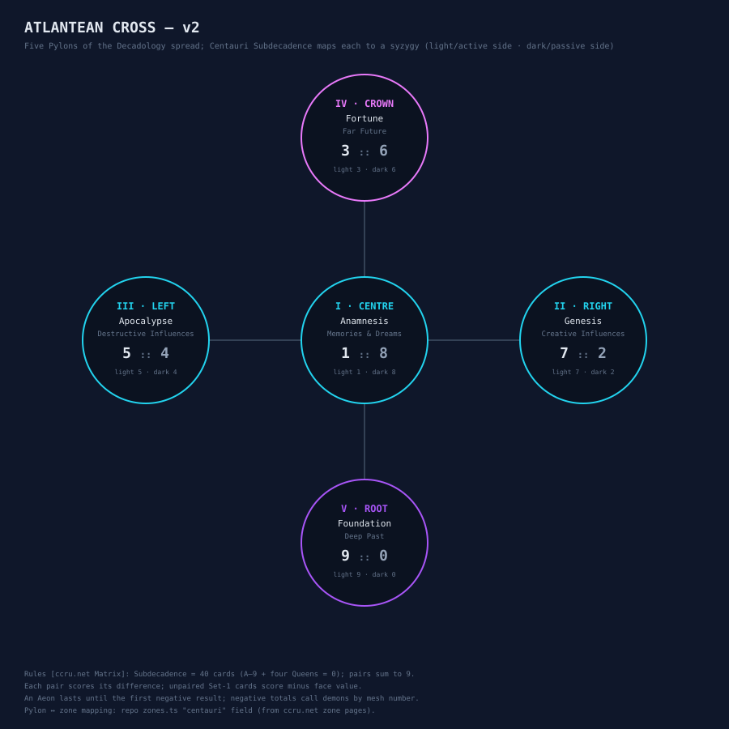

# Subdecadence Deck Project

> Project log / decision journal for a physical 45-card oracle deck derived from the Pandemonium Matrix and the existing demon-card / syzygy-card visual assets.

## Overview

The numogram already has 45 fully rendered demon SVGs (`assets/demon-cards/`), 5 syzygy cards, zone-glyph sprites, and a completed Atlantean Cross spread diagram. The deck project is an **assembly and annotation layer** on top of those assets, with two differentiating ideas:

- **Zone-glyph integration**: reuse the existing `assets/zone-glyphs/` 32x32 pixel sprites as a consistent card-back or bottom-corner motif. This ties each demon to its primary zone and lets the deck read as both a demonology set and a zone-traversal set.
- **Wide card space utilization**: the current SVG template is 360x500 with room to spare. Second uses for the surplus: 9-sum complement indicator, current vector, seed/note area, and pairing cheat strip.

## Existing Assets (don't rebuild)

- `assets/demon-cards/demon-*.svg` — 45 cards, Tokhatto = demon-10
- `assets/syzygy-cards/syzygy-*-*.svg` — 5 syzygy pairs
- `assets/subdecadence-atlantean-cross.svg` — spread reference

*v2 (Em, 1 Nov 2026): the original is kept. The v2 maps the five Pylons to syzygies (1::8, 7::2, 5::4, 3::6, 9::0) from the repo's `zones.ts` centauri field and ccru.net zone pages. It drops the original's unsourced Tokhatto "current Hold" and 5::5 centre.*

- `assets/zone-glyphs/zone-N.png` — 10 zone sprites
- `assets/zone-sprites/zone-N-sprite.png` — hardware-palette variants
- `pandemonium-matrix.md` + `pandemonium.md` — structural copy
- `demon-encyclopedia.md` — complete roster / pitch / net-span
- `subdecadence.md` — live game rules + Atlantean Cross

## Deck Variants

### A — 45-card oracle/pool deck (preferred)
Reuse `demon-cards/*.svg` with three small additions:
1. **Zone-glyph selector** — bottom-left stamp per zone letter or PNG
2. **Complement column** — border tab showing 9-sum pair value
3. **Governor seal** — Tokhatto gets a distinct back or `Governor` tag

### B — 40-card play deck + 5 governor tokens
Drop the 5 carrier demons (Katak, Djynxx, Oddubb, Mur Mur, Uttunul) into token form; remaining 40 map cleanly to four suits x 0-9. Tokhatto as M#10 sits outside play as the rules token.

> **Verification note (Em, 1 Nov 2026):** the CCRU mapping is different [ccru.net, [Pandemonium](http://www.ccru.net/digithype/pandemonium.htm)]:
- Decadology assigns cards only to the **36 Amphidemons and Cyclic Chronodemons**: 9 cluster types × 4, matching the **36-card Decadence pack (A–9)**. The matrix codes map Mj+ to Clubs, Mn+ to Hearts, Mj− to Spades and Mn− to Diamonds.
- **Katak** is the one syzygetic demon with a card, the Joker.
- The four **chaotic xenodemons** (Ixix 3::0, Tchu 6::0, Ununuttix 9::3, Unnutchi 9::6) have **no** card.
- The four Subdecadence **Queens (= 0)** have no CCRU demon assignment. The Vexsys "Lessons in Time Sorcery" PDF assigns the xenodemons to them by inference; that is fan reconstruction.

So "the remaining 40 map cleanly to four suits × 0–9" is a **design choice, not CCRU**. Tokhatto (Mesh-10) is not outside play in the source: it has the card **[9S]** and is titled "Angel of the Cards".

### C — Reversible bifacial
Face = demon SVG; back = value card (9-sum complement printed in zone color). Manufacture via acetate sleeve or a double-sided PDF. Highest material complexity, highest gameplay density.

## Experiment Notes

- **2026-06-02** — vault/export drift noted; `docs/wiki/subdecadence-deck.md` does not yet exist in either tree. Authoring in vault first until explicit sync action.
- Slot usage audit on current demon-card SVG: ample space below the `Δ─────────Δ` separator row. A \"PANDEMONIUM\" row and a 9-sum slot tag fit without crowding. Suggest wider bottom section for typographic metadata (pitch class, demon type, AQ gate).
- Zone-glyph palette and demon-card palette should share the same zone->color mapping used in `assets/zone-palettes.json` so any future print/mask layer is consistent.

## Nomenclature & Pitch (Design Layer)

Demon cards already carry one-line archetypes (\"Amphidemon of Talismania\", \"Decimal Camouflage, number as destiny, Angel of the Cards\"). For the deck variant these become **attribute pills** or a wrapped line between the name block and the separator.

Pitch system (from `unleashing-the-numogram-source` — may need updating):
- **Ana-N** (highest) → far-apart zones, screaming register
- **Cth-N** (lowest) → close zones, rumbling register
- **Null** → syzygetic / carrier demons, silence

> **Verification note (Em, 1 Nov 2026):** pitch is **not** ordered by zone distance. Examples: 4::3 Skarkix (span 1) is **Ana-7**, the uppermost pitch; 6::5 Tchattuk (span 1) is **Cth-7**, the lowermost; 1::0 Lurgo is Ana-1. The null-pitch list is exhaustive: "All syzygetic demons have a neutral (or Null) pitch", and only the five syzygetic demons are Null in the matrix [ccru.net, Pandemonium].

Possible card embedding:
- Micro-ledger gains a `Pitch:Cth-4` slot
- Zone-glyph color/orientation shifts by pitch tier (optional)
- Null-pitch demons get a `◎` marker on the card face

## Pitch Research Target

Upstream source: [[unleashing-the-numogram-source]]
- Verify the complete Ana-7 … Cth-7 continuum mapping
- Confirm whether null-pitch list is exhaustive (likely 5 carrier demons)
- Check if pitch correlates with net-span distance or current class

## Next Actions

1. Add zone-glyph selector + complement tab to one donor SVG (demon-10-tokhatto) as a prototype
2. Produce low-res CGI stills of front/back variants to check legibility
3. Add backlinks from `visual-hub.md` and `pandemonium-matrix.md`

## Image Inspection Method (future)

SVG visual inspection via browser + vision:
- `browser_navigate` to `file:///…/asset.svg` renders the SVG in a local browser frame
- `browser_vision` then returns an annotated description + screenshot even when CLI renderers fail on namespace errors
- Works despite inline `xlink:href` namespace issues that block `rsvg-convert` and ImageMagick
- Confirmed usable on `syzygy-4-5.svg` 2026-06-02

Cross-links (Em, 1 Nov 2026): [[decadence]] · [[subdecadence]] · [[pandemonium]] · [[pandemonium-matrix]]
