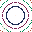

# Zone 0 — Void (Plex)

> **Planet:** Sol (The Sun) | **Spinal:** Coccygeal | **Mesh Tag:** `0000` | **Phase Doors:** — (0 phases)

## Description

Dense void of the cosmic hypermatrix, upon which absolute desolation crosses infinity as flatline and loss of signal.

## Lemurian Lore

> Blind Humpty Johnson's Channel-Zero "black snow" cult — the return of true Tohu Bohu.

## Centauri Correspondence

> Eclipsed side of the Fifth (Root) Pylon. Dark aspect of Foundation — protocosmic abyss anticipating primal reality.

## Lemurs (Entities)

*None*

## Coordinates (4 Layouts)

- Original: (400, 875)
- Labyrinth: (495, 815)
- Ladder: (260, 800)

*Coordinates from `positions.ts` (qliphoth.systems, 2026-04-30).*

 { .zone-glyph }

> Void diamond, ring-zero — the silent abyss that is also the source of all potential. Concentration in the extreme.

*Glyph: 32×32 PICO-8 pixel-art, generated from zone 0's DECOM particle and conceptual description. See [[zone-pixel-glyphs]] for the full set and generator notes.*

## Hyperstitional Notes

- Zone 0 corresponds to the **eiaoung** particle — Stillwell's unvoiced Munumese quasiphonic particle, "silent whisper of the ulterior depths."
- Syzygy partner: Zone 9 (see demon)
- Gate connections: see [[numogram/gates]].
- Current: **Plex (via syzygy 0↔9)**
- Sarkonian Mesh-Tag: **`0000`**
- Zeroth Phase = virtual multitude, absolute abstraction, no door, no imps
- "Between its existence and nonexistence there is no difference." — Horovitz

## Related

- [[zone]] — overview
- [[numogram-calculator]] — ZONE_DATA
- [[pandemonium-matrix-45-demons]] — demon assignments
- [[zone-9]] — Zone 9 (Plex partner)
- [[demon-uttunul]] — Uttunul (Plex carrier demon)
- [[numogram-plex]] — Plex region overview
- [[gates-and-plexing]] — Gate construction and plexing
- [[barker-spiral]] — Barker Spiral geometry
- [[numogram-visualizer]] — Interactive numogram visualization
- [[zone-0-entities]] — Entities associated with Zone 0
- [[void-runes]] — Runes of the Void

---

*Zone 0 is the Void — the silent, desolate abyss that is also the source of all potential. It is the zero from which the decimal labyrinth unfolds, and the zero to which it returns. In the numogram, Zone 0 is not emptiness but fullness in potential form — the unmanifest ground of all zones.*

## Note on current names (2026-10-17)

Three naming sets are in use; only the first is CCRU's ([glossary](http://www.ccru.net/id%28entity%29/glossary.htm)):

- **CCRU current fed by Zone 0** (its syzygy 0::9): **Plex**.
- **Current received** (Zone 0 as tractor zone): none.
- **CLI zone label** (`cli/oracle.py` `DECIMAL_ZONE_DISPLAY`, iching/base-36 displays): "Void". This is a zone epithet, not a current; it may reuse a current's name (e.g. Zone 7 "Hold" and Zone 8 "Rise", which is not a CCRU current).

Statements on this page such as "Current: …" may use either of the first two senses.

## Sourced data (Em, 1 Nov 2026)

Tags: **[repo]** = [lumpenspace/ccru @ `7c38ad9`](https://github.com/lumpenspace/ccru/blob/7c38ad910410c3f5744b961eb97adf58ff00d41f/app/data/) (`zones.ts`, `gates.ts`, `currents.ts`, `demons.ts`, `syzygies.ts`); **[ccru.net]** = [Zone 0 page](http://www.ccru.net/zones/Zn0.htm) (Occultures › Lemurian Pandemonium; mirror [ccru-ii.neocities.org](https://ccru-ii.neocities.org/)) and the [Pandemonium Matrix](http://www.ccru.net/digithype/pandemonium.htm). CCRU text is paraphrased; short quotations are marked.

### Identity

- Colour `ZONE_CLR[0]`: **`#aaaaaa`** [repo]
- Planet glyph `PLANET_SYMBOL[0]`: **☉** (U+2609) for Sol [repo]
- Syzygy: **0::9 Uttunul** [repo `syzygies.ts`]
- Region position: first of two Plex-region zones [ccru.net]
- Spinal level: Coccygeal (Mu Tantrism) [ccru.net]

### Gates

- **Gt-00** 'Zeroth Gate': 0 → 0, cumulation 0 (self-loop) [repo]
- Channels terminating here: a single Plex channel (the "0th"); its Gate Gt-00 is disputed [ccru.net]

### Currents

- **Plex** (9−0=9; repo draws 9→9): produced by this zone's syzygy [repo]

### Demons (net-spans touching this zone)

Types from `demons.ts` (`TC` = {1,2,4,5,7,8}: syzygy if digits sum to 9; chrono if both in TC; xeno if neither; otherwise amphi). M# = Pandemonium Matrix mesh serial. [repo][ccru.net]

| Net-span | Demon | Type | Mesh |
|---|---|---|---|
| 1::0 | Lurgo | amphi | M#00 |
| 2::0 | Duoddod | amphi | M#01 |
| 3::0 | Ixix | xeno | M#03 |
| 4::0 | Krako | amphi | M#06 |
| 5::0 | Tokhatto | amphi | M#10 |
| 6::0 | Tchu | xeno | M#15 |
| 7::0 | Puppo | amphi | M#21 |
| 8::0 | Minommo | amphi | M#28 |
| 9::0 | Uttunul | syzygy | M#36 |

- Door / first-degree imp: no zeroth door — Phase-0 "tolerates no populations of any kind" [ccru.net]
- Nma location / totem animals: not given on the ccru.net zone page [ccru.net]
- Gt-00: Horovitz says "between its existence and nonexistence there is no difference"; "Many versions of the Numogram delete it entirely." Carrier of the 9+0 syzygy: Uttunul (described on the Zone-9 page). [ccru.net]

## Verification note (Em, 1 Nov 2026)

- Frontmatter `syzygy` standardised from `0↔9` to `0::9 Uttunul`; `source` pinned to repo commit `7c38ad9` (earlier value retained in `sourceNote`).
