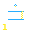

# Zone 1 — Stability (Torque)

> **Planet:** Mercury (Sol-1) | **Spinal:** Dorsal (Thoracic) | **Mesh Tag:** `0001` | **Phase Doors:** Lurgo — the Initiator (Door of Doors) (2 phases)

## Description

Meta-static pod-deliria and techno-immortalism. Transcendent sky-god divinity and archaic gnosis of the shelled Old One who supports the world.

## Lemurian Lore

> Turtle cults and bubble-pod techno-immortalism. The primordial click of Tzikvik cipher-shamanism.

## Centauri Correspondence

> Palpable side of the First (Center) Pylon. Light aspect of Anamnesis — enduring ideas, historical time and remembrance.

## Lemurs (Entities)

- 1::0 Lurgo

## Coordinates (4 Layouts)

- Original: (400, 550)
- Labyrinth: (400, 655)
- Ladder: (260, 625)

*Coordinates from `positions.ts` (qliphoth.systems, 2026-04-30).*

## Visual

 { .zone-glyph }

> Door/gag reflex — the inaugural inhalation, a glottal gateframe. The word itself recoils before speech.

*Glyph: 32×32 PICO-8 pixel-art, generated from zone 1's DECOM particle and conceptual description. See [[zone-pixel-glyphs]] for the full set and generator notes.*

## Hyperstitional Notes

- Zone 1 corresponds to the **gl** particle.
- Syzygy partner: Zone 8 (see demon)
- Gate connections: see [[numogram/gates]].
- Current: **Sink**

### One is a Number Among Many Others

Land's philosophical demotion of unity — the anti-emanationist core of the Numogram:

> *"The exoteric Tetractys (1+2+3+4=10) valorizes unity. Ten is the vehicle of the valorization of unity... The esoteric Tetractys is different. We have zero at the top of our esoteric Tetractys. It's the empty summit. One is a number among many others."*

In the Esoteric Tetractys, Zone 1 heads the stable-identity basin: zones 1, 4, and 7 all converge to digital root 1 under Masonic arithmetic. Unlike the Warp basin (3↔6) which has no fixed point, the 1-basin is the **principle of identity** in the decimal system — the attractor that holds zones together rather than dispersing them.

Zone 1 also occupies the 2⁶ position in the Iron Law of Six cycle:

| 2ⁿ | Dr | Zone |
|----|----|------|
| 2⁶ | 64→1 | Z1 — cycle reset |
| 2¹ | 2 | Z2 |
| 2² | 4 | Z4 |
| 2³ | 8 | Z8 |
| 2⁴ | 7 | Z7 |
| 2⁵ | 5 | Z5 |

The power-of-2 cycle resets through Zone 1 every six doublings — the point where the binary returns to unity before recirculating. This is the **initiating spark** of the Time Circuit: Land's "1" at the start of the `1→8→2→7→5→4→1` anticlockwise rotor.

## Related

- [[zone]] — overview
- [[numogram-calculator]] — ZONE_DATA
- [[pandemonium-matrix-45-demons]] — demon assignments

## Note on current names (2026-10-17)

Three naming sets are in use; only the first is CCRU's ([glossary](http://www.ccru.net/id%28entity%29/glossary.htm)):

- **CCRU current fed by Zone 1** (its syzygy 1::8): **Surge**.
- **Current received** (Zone 1 as tractor zone): Sink (4::5 → 1).
- **CLI zone label** (`cli/oracle.py` `DECIMAL_ZONE_DISPLAY`, iching/base-36 displays): "Surge". This is a zone epithet, not a current; it may reuse a current's name (e.g. Zone 7 "Hold" and Zone 8 "Rise", which is not a CCRU current).

Statements on this page such as "Current: …" may use either of the first two senses.
