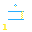

# Zone 1 — Stability (Torque)

> **Planet:** Mercury (Sol-1) | **Spinal:** Dorsal (Thoracic) | **Mesh Tag:** `0001` | **Phase Doors:** Lurgo — the Initiator (Door of Doors) (2 phases)

## Description

Meta-static pod-deliria and techno-immortalism. Transcendent sky-god divinity and archaic gnosis of the shelled Old One who supports the world.

## Lemurian Lore

> Turtle cults and bubble-pod techno-immortalism. The primordial click of Tzikvik cipher-shamanism.

## Centauri Correspondence

> Palpable side of the First (Center) Pylon. Light aspect of Anamnesis — enduring ideas, historical time and remembrance.

## Lemurs (Entities)

- 1::0 Lurgo

## Coordinates (4 Layouts)

- Original: (400, 550)
- Labyrinth: (400, 655)
- Ladder: (260, 625)

*Coordinates from `positions.ts` (qliphoth.systems, 2026-04-30).*

## Visual

 { .zone-glyph }

> Door/gag reflex — the inaugural inhalation, a glottal gateframe. The word itself recoils before speech.

*Glyph: 32×32 PICO-8 pixel-art, generated from zone 1's DECOM particle and conceptual description. See [[zone-pixel-glyphs]] for the full set and generator notes.*

## Hyperstitional Notes

- Zone 1 corresponds to the **gl** particle.
- Syzygy partner: Zone 8 (see demon)
- Gate connections: see [[numogram/gates]].
- Current: **Sink**

### One is a Number Among Many Others

Land's philosophical demotion of unity — the anti-emanationist core of the Numogram:

> *"The exoteric Tetractys (1+2+3+4=10) valorizes unity. Ten is the vehicle of the valorization of unity... The esoteric Tetractys is different. We have zero at the top of our esoteric Tetractys. It's the empty summit. One is a number among many others."*

In the Esoteric Tetractys, Zone 1 heads the stable-identity basin: zones 1, 4, and 7 all converge to digital root 1 under Masonic arithmetic. Unlike the Warp basin (3↔6) which has no fixed point, the 1-basin is the **principle of identity** in the decimal system — the attractor that holds zones together rather than dispersing them.

Zone 1 also occupies the 2⁶ position in the Iron Law of Six cycle:

| 2ⁿ | Dr | Zone |
|----|----|------|
| 2⁶ | 64→1 | Z1 — cycle reset |
| 2¹ | 2 | Z2 |
| 2² | 4 | Z4 |
| 2³ | 8 | Z8 |
| 2⁴ | 7 | Z7 |
| 2⁵ | 5 | Z5 |

The power-of-2 cycle resets through Zone 1 every six doublings — the point where the binary returns to unity before recirculating. This is the **initiating spark** of the Time Circuit: Land's "1" at the start of the `1→8→2→7→5→4→1` anticlockwise rotor.

> **Verification note (Em, 1 Nov 2026):** the sequence 1→8→2→7→5→4 used here lists the Time-Circuit syzygies (1::8, 2::7, 5::4). It is not a route. The zones follow the doubling cycle **1→2→4→8→7→5** (digital roots of 2ⁿ) [ccru.net, [declab](http://www.ccru.net/declab.htm)], and the currents run Surge 8→7, Hold 2→5, Sink 4→1 [ccru.net Matrix; repo]. Left as written because this is commentary; see [[time-circuit]].

## Related

- [[zone]] — overview
- [[numogram-calculator]] — ZONE_DATA
- [[pandemonium-matrix-45-demons]] — demon assignments

## Note on current names (2026-10-17)

Three naming sets are in use; only the first is CCRU's ([glossary](http://www.ccru.net/id%28entity%29/glossary.htm)):

- **CCRU current fed by Zone 1** (its syzygy 1::8): **Surge**.
- **Current received** (Zone 1 as tractor zone): Sink (4::5 → 1).
- **CLI zone label** (`cli/oracle.py` `DECIMAL_ZONE_DISPLAY`, iching/base-36 displays): "Surge". This is a zone epithet, not a current; it may reuse a current's name (e.g. Zone 7 "Hold" and Zone 8 "Rise", which is not a CCRU current).

Statements on this page such as "Current: …" may use either of the first two senses.

## Sourced data (Em, 1 Nov 2026)

Tags: **[repo]** = [lumpenspace/ccru @ `7c38ad9`](https://github.com/lumpenspace/ccru/blob/7c38ad910410c3f5744b961eb97adf58ff00d41f/app/data/) (`zones.ts`, `gates.ts`, `currents.ts`, `demons.ts`, `syzygies.ts`); **[ccru.net]** = [Zone 1 page](http://www.ccru.net/zones/Zn1.htm) (Occultures › Lemurian Pandemonium; mirror [ccru-ii.neocities.org](https://ccru-ii.neocities.org/)) and the [Pandemonium Matrix](http://www.ccru.net/digithype/pandemonium.htm). CCRU text is paraphrased; short quotations are marked.

### Identity

- Colour `ZONE_CLR[1]`: **`#ee44ee`** [repo]
- Planet glyph `PLANET_SYMBOL[1]`: **☿** (U+263F) for Mercury [repo]
- Syzygy: **1::8 Murrumur** [repo `syzygies.ts`]
- Region position: first of six Torque zones [ccru.net]
- Spinal level: Dorsal (Thoracic) [ccru.net]

### Gates

- **Gt-01** 'First Gate': 1 → 1, cumulation 1 (self-loop) [repo]
- **Gt-10** 'Gate of Submergence': 4 → 1, cumulation 10 (into this zone) [repo]
- **Gt-28** 'Gate of Relapse': 7 → 1, cumulation 28 (into this zone) [repo]
- Channels terminating here: three Torque channels (1st, 4th, 7th — i.e. Gt-01, Gt-10, Gt-28) [ccru.net]

### Currents

- **Sink** (5−4=1; repo draws 4→1): this is the tractor zone [repo]
- **Surge** (8−1=7; repo draws 8→7): produced by this zone's syzygy [repo]
- Tractor-Zone of the 5-4 ('Sink') Current [ccru.net]

### Demons (net-spans touching this zone)

Types from `demons.ts` (`TC` = {1,2,4,5,7,8}: syzygy if digits sum to 9; chrono if both in TC; xeno if neither; otherwise amphi). M# = Pandemonium Matrix mesh serial. [repo][ccru.net]

| Net-span | Demon | Type | Mesh |
|---|---|---|---|
| 1::0 | Lurgo | amphi | M#00 |
| 2::1 | Doogu | chrono | M#02 |
| 3::1 | Ixigool | amphi | M#04 |
| 4::1 | Sukugool | chrono | M#07 |
| 5::1 | Tukkamu | chrono | M#11 |
| 6::1 | Djungo | amphi | M#16 |
| 7::1 | Bubbamu | chrono | M#22 |
| 8::1 | Murrumur | syzygy | M#29 |
| 9::1 | Tuttagool | amphi | M#37 |

> **Verification note (Em, 1 Nov 2026):** Tuttagool/Unnunaka follow the Zone 9 page ([Zn9](http://www.ccru.net/zones/Zn9.htm)) and the repo. The Pandemonium Matrix ([pandemonium.htm](http://www.ccru.net/digithype/pandemonium.htm)) spells them **Tutagool** and **Ununak**. Both forms are CCRU; see [[pandemonium-matrix#name-and-spelling-variants]].

- Door / first-degree imp: First Door, the 'Door of Doors': Lurgo (1::0) 'the Initiator', widely related to Legba ("the first and last Loa to be invoked") [ccru.net]
- Nma location (Stillwell's ethno-topography): coral atolls of the Mu Nma; hydrocycle: shallow seas [ccru.net]
- Totem animals: armoured fish creatures (ichthyoid with crustacean/mollusc/gastropod traits) [ccru.net]
- Mesh-tag 0001 'matching the primordial click of Tzikvik cipher-shamanism'. Gt-01 linked to all variants of the Bubble-Pod mythos. [ccru.net]

## Verification note (Em, 1 Nov 2026)

- Frontmatter `syzygy` was empty; set to `1::8 Murrumur`. Spelling: repo and ccru.net lemur lists give **Murrumur**; the ccru.net Zone 1/8 system notes say **Murmur**; the Pandemonium Matrix gives 'Mur Mur (Murrumur, Mu(mu))'. All refer to 8::1.
