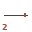

# Zone 2 — Separation (Torque)

> **Planet:** Venus (Sol-2) | **Spinal:** — | **Mesh Tag:** `0003` | **Phase Doors:** Duoddod — Main Lo-Way into the Crypt (4 phases)

## Description

Crypt-navigation, occulted cyberspace. Spectral populations of hallucination and time fragmentation — greys, ghosts and zombies.

## Lemurian Lore

> Mirrors Zone-5 — shared Hyperborean themes of time-lapse and abduction. Mist, vaporization and hazing.

## Centauri Correspondence

> Eclipsed side of the Second (Right) Pylon. Dark aspect of Genesis — epidemic fertility, clones, vampiric contagion.

## Lemurs (Entities)

- 2::0 Duoddod
- 2::1 Doogu

## Coordinates (4 Layouts)

- Original: (560, 275)
- Labyrinth: (400, 220)
- Ladder: (260, 450)

*Coordinates from `positions.ts` (qliphoth.systems, 2026-04-30).*

 { .zone-glyph }

> Imploded fricative, stutter fracture, angle tick — the Shperer fracture vertical. A break that never quite closes.

*Glyph: 32×32 PICO-8 pixel-art, generated from zone 2's DECOM particle and conceptual description. See [[zone-pixel-glyphs]] for the full set and generator notes.*

## Hyperstitional Notes

- Zone 2 corresponds to the **dt** particle.
- Syzygy partner: Zone 7 (see demon)
- Gate connections: see [[numogram/gates]].
- Current: **Flow**

### The Initiating Split

In the Iron Law of Six, Zone 2 is the first doubling: **2¹ = 2**. Binary exponentiation begins here — the minimal separation from unity that makes all subsequent doubling possible. The cycle's first step outward from the initiating spark.

In the Esoteric Tetractys, Zone 2 falls into the **Warp 3↔6 basin**: T₂=3 (the second triangle), which feeds directly into the 3↔6 self-loop. This makes Zone 2 structurally unstable — it appears in the Time Circuit (`1→8→2→7→5→4→1`) but its basin affiliation is with the vortex. Separation (Z2's name) is thus not a stable state but a **leak vector**: the zone where the Time Circuit's drive toward Warp expresses itself.

Land's full derivation supports this: 2, 3, 5, and 6 all orbit the 3↔6 vortex with no rest state. Zone 2 is the first member of the Time Circuit to be "captured" by Warp gravitationalt — the moment in the anticlockwise rotor where cyclicity begins to fray.

### Mirror with Zone 5

As the raw notes already observe, Zone 2 mirrors Zone 5 (shared Hyperborean themes). The Esoteric Tetractys confirms this structurally: both 2 and 5 fall into the 3↔6 basin. They are the Time Circuit's two "Warp-leak" zones — the points where the circuit's self-containment fails and outer-time bleeds in.

## Related

- [[zone]] — overview
- [[numogram-calculator]] — ZONE_DATA
- [[pandemonium-matrix-45-demons]] — demon assignments

**Pentagram coordinate:** **Outer ring right** (0° vertex in chord-pentagram)

## Note on current names (2026-10-17)

Three naming sets are in use; only the first is CCRU's ([glossary](http://www.ccru.net/id%28entity%29/glossary.htm)):

- **CCRU current fed by Zone 2** (its syzygy 2::7): **Hold**.
- **Current received** (Zone 2 as tractor zone): none.
- **CLI zone label** (`cli/oracle.py` `DECIMAL_ZONE_DISPLAY`, iching/base-36 displays): "Dt". This is a zone epithet, not a current; it may reuse a current's name (e.g. Zone 7 "Hold" and Zone 8 "Rise", which is not a CCRU current).

Statements on this page such as "Current: …" may use either of the first two senses.

## Sourced data (Em, 1 Nov 2026)

Tags: **[repo]** = [lumpenspace/ccru @ `7c38ad9`](https://github.com/lumpenspace/ccru/blob/7c38ad910410c3f5744b961eb97adf58ff00d41f/app/data/) (`zones.ts`, `gates.ts`, `currents.ts`, `demons.ts`, `syzygies.ts`); **[ccru.net]** = [Zone 2 page](http://www.ccru.net/zones/Zn2.htm) (Occultures › Lemurian Pandemonium; mirror [ccru-ii.neocities.org](https://ccru-ii.neocities.org/)) and the [Pandemonium Matrix](http://www.ccru.net/digithype/pandemonium.htm). CCRU text is paraphrased; short quotations are marked.

### Identity

- Colour `ZONE_CLR[2]`: **`#4488ff`** [repo]
- Planet glyph `PLANET_SYMBOL[2]`: **♀** (U+2640) for Venus [repo]
- Syzygy: **2::7 Oddubb** [repo `syzygies.ts`]
- Region position: second of six Torque zones [ccru.net]
- Spinal level: none on the zone page (repo blank; Pandemonium Matrix gives Duoddod's door Cervical) [ccru.net]

### Gates

- **Gt-03** 'Lo-Way to the Crypt': 2 → 3, cumulation 3 (out of this zone) [repo]
- Channels terminating here: none listed [ccru.net]

### Currents

- **Hold** (7−2=5; repo draws 2→5): produced by this zone's syzygy; drawn from this zone in the repo [repo]

### Demons (net-spans touching this zone)

Types from `demons.ts` (`TC` = {1,2,4,5,7,8}: syzygy if digits sum to 9; chrono if both in TC; xeno if neither; otherwise amphi). M# = Pandemonium Matrix mesh serial. [repo][ccru.net]

| Net-span | Demon | Type | Mesh |
|---|---|---|---|
| 2::0 | Duoddod | amphi | M#01 |
| 2::1 | Doogu | chrono | M#02 |
| 3::2 | Ixidod | amphi | M#05 |
| 4::2 | Skoodu | chrono | M#08 |
| 5::2 | Kuttadid | chrono | M#12 |
| 6::2 | Djuddha | amphi | M#17 |
| 7::2 | Oddubb | syzygy | M#23 |
| 8::2 | Nammamad | chrono | M#30 |
| 9::2 | Unnunddo | amphi | M#38 |

- Door / first-degree imp: Second Door, the 'Main Lo-Way' into the Crypt (K-goth): Duoddod (2::0) [ccru.net]
- Nma location (Stillwell's ethno-topography): interior marshlands of the Dib Nma; hydrocycle: mist, vaporisation, hazing [ccru.net]
- Totem animals: metamorphic insects — moths, butterflies, dragonflies, dibboma flashbugs [ccru.net]
- Gt-03 (written 'Gt-3' on ccru.net) is honoured and feared by Tzikvik shamanism as the opening to the 'way of the Storm-Worm'. [ccru.net]

## Verification note (Em, 1 Nov 2026)

- Frontmatter `syzygy` standardised to `2::7 Oddubb`. ccru.net writes the gate as 'Gt-3'; repo pads it as 'Gt-03' (same gate).
